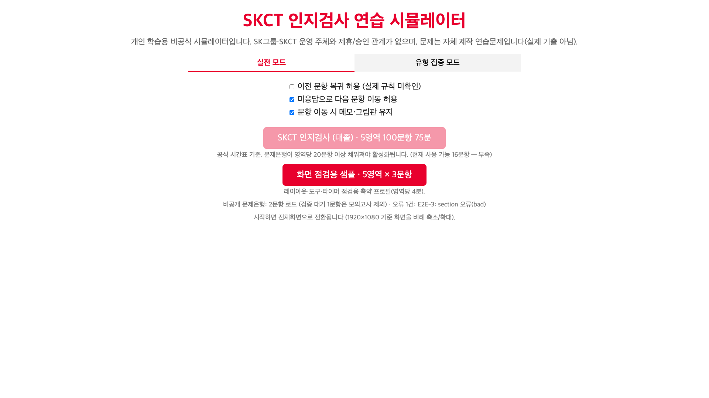
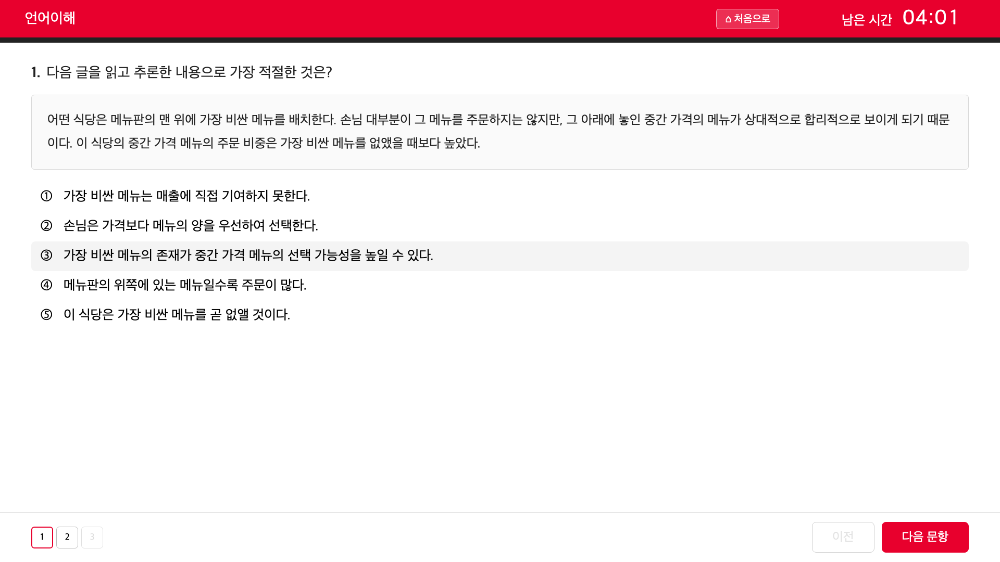
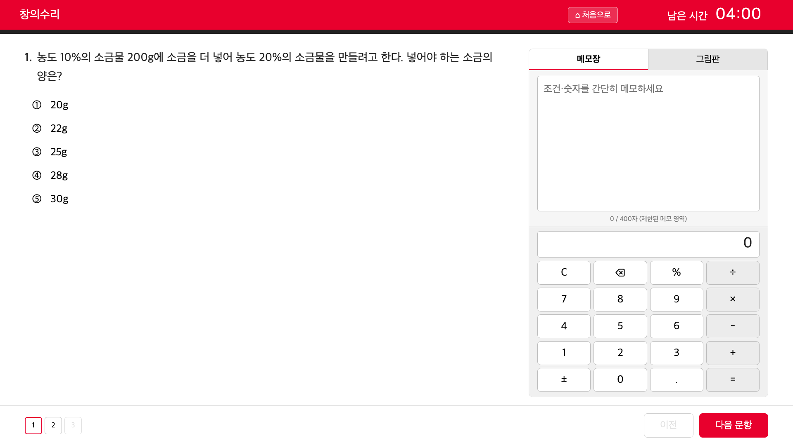
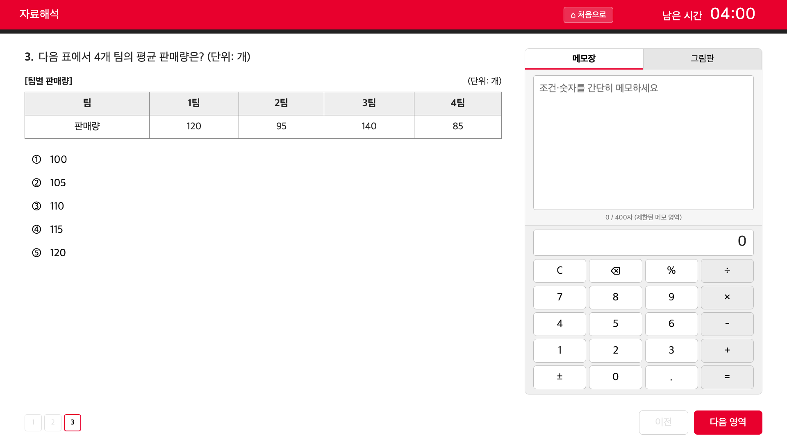
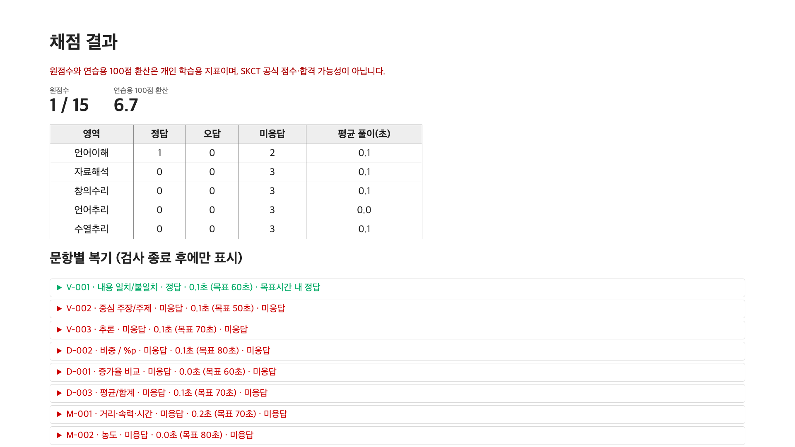

**English** · [한국어](README.ko.md)

# SKCT Practice Simulator (Unofficial)

> **This is an unofficial personal study project.** It is not affiliated with, sponsored by, or approved by SK Group, SK C&C, or the operators of SKCT, and it is not an official test program. Names such as "SKCT" are used only to describe which test this practice tool prepares for; it contains no related trademarks, logos, images, source code, or real exam questions.

A **personal-study** CBT that recreates the SKCT cognitive-ability online test screen as closely as possible. It has no relation to SK Group or the official SKCT.

- A fixed 1920×1080 stage is scaled proportionally to the viewport → the real test's screen ratio is kept on any monitor
- Per-section deadline-based timer (accurate across refresh and background), 1-minute break between sections
- Verbal comprehension: no tools (full-width questions) / other sections: notepad and paint tabs + calculator
- Answers and explanations hidden during the test; scoring, review and a study-record dashboard after it ends
- Real-test mode draws questions randomly with a new seed each time; focus mode filters by section, sub-type, difficulty, study status, question count and time
- Retrain on only unsolved, recently wrong, or recently timed-out questions. The same random seed reproduces the same set
- Question bank: 15 self-written questions (not official past exams); calculation and logic items are independently verified in `src/data/questions.test.ts`

## Screens (at 1920×1080, a personal-study recreation — not the official screens)
| Start | Verbal comprehension (no tools, full width) |
|---|---|
|  |  |

| Creative math (notepad / paint tabs + calculator) | Data interpretation (table) |
|---|---|
|  |  |



> The app UI itself is in Korean, so the screenshots are shared by both language versions.

## Run
```bash
npm install
npm run dev      # http://localhost:5173
npm test         # unit tests
npm run e2e      # Playwright (screenshots: e2e/shots)
npm run privacy-check # checks that private material is not in the index, staging, history or build
npm run generate-bank # generates self-made questions into private/bank following the Notion type scheme
```

`npm install` enables `.githooks`, and the privacy check runs automatically right before a push. `git commit` only makes a local record; nothing is sent to the remote unless you run `git push` or a separate Sync.

## Basis and unverified points
- Confirmed: the official candidate guide (20 questions and 15 minutes per section, recommended 1920×1080, full screen) and the author's recollection (1-minute break, only verbal comprehension has no tools)
- Unverified (configurable): going back to a previous question, the calculator's operation order and key layout, detailed notepad / paint features

## Copyright and legal notice
- Every question in this repository is a **self-made practice question**, not a real SKCT past or reconstructed question. Scores are practice indicators, not official scores or a chance of passing.
- Do not upload commercial textbooks, e-books, paid material, or real exam questions here. Keep personal material only in the `private/` folder (git-ignored) and use it only for your own study. No DRM-bypass feature is provided.
- No screen captures, assets, or code from the official test program are included; the screens were newly built from general information in the public candidate guide and the author's recollection.
- Users are responsible for their own use, and this document is not legal advice. Content will be removed at the rights holder's request.
- The code is under the [MIT License](LICENSE) (including question data, excluding trademarks and third-party material).
